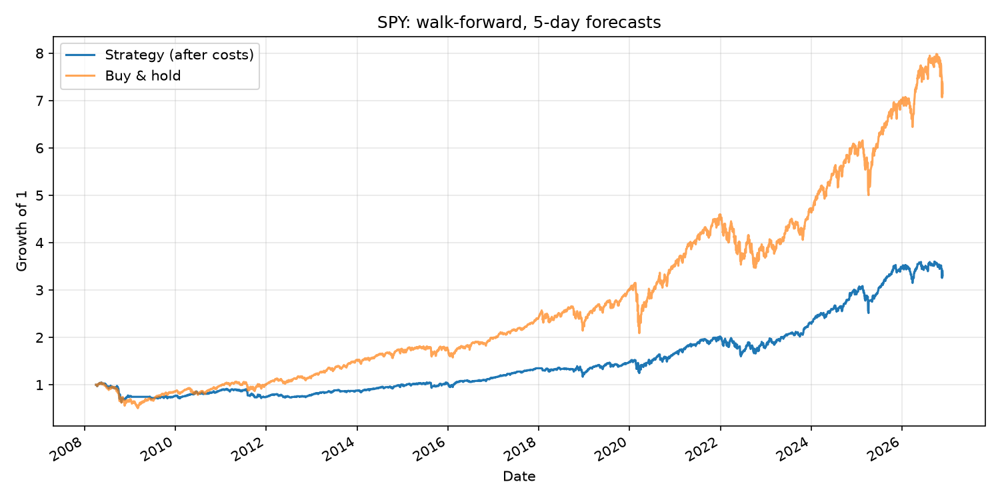

# Market Prediction System

Does a random forest find a usable short-term signal in simple price features? This project answers that honestly: forecasts are made walk-forward, the model only ever trains on labels that were known at the time, and the backtest charges transaction costs.

## How it works

```
prices ──► features (returns, moving-average gaps, volatility ratios)
       ──► label: return from today's close to the close 5 days later
       ──► walk-forward random forest (retrained every quarter)
       ──► long/flat signal: hold the asset when the forecast is positive
       ──► backtest on the next day's return, minus costs
```

| Choice | Why |
|---|---|
| Returns and ratios as features, no raw prices | Price levels drift out of the range the trees were trained on; ratios don't |
| Walk-forward, retrained every 63 days | Each forecast comes from a model that never saw that period |
| Five-day embargo | A five-day label needs prices five days ahead, so the last five days before each block are left out of its training set |
| Trade on the next day | The signal is decided at today's close and earns tomorrow's return |
| Costs per trade (default 5 bps) | A daily signal trades often; results before costs mislead |
| Long/flat, not long/short | Easier to compare with buy-and-hold and closer to how a long-only investor would use it |

## Quick start

```bash
pip install -r requirements.txt
python main.py                                    # SPY from 2005
python main.py --ticker QQQ --cost-bps 10 --chart outputs/qqq.png
python main.py --csv data/prices.csv              # your own Date,Close file
```

The script prints the out-of-sample information coefficient (rank correlation between forecast and realised return), the hit rate, and a table comparing the strategy with buy-and-hold: annual return, volatility, Sharpe ratio (risk-free rate set to zero), maximum drawdown, time in the market and trades per year.

## Results

SPY daily prices from January 2005 to November 2026. Forecasts are out of sample from April 2008 (4,689 days), with 5 basis points of cost per trade.

| | Strategy | Buy & hold |
|---|---|---|
| Annual return | 6.6% | 11.1% |
| Annual volatility | 15.8% | 19.7% |
| Sharpe ratio | 0.49 | 0.63 |
| Maximum drawdown | -40.0% | -51.5% |
| Time in the market | 67% | 100% |
| Trades per year | 55 | 0 |

The forecasts are barely better than chance: an information coefficient of 0.022 and a 53.5% hit rate. Being out of the market a third of the time lowers volatility and the worst loss, but misses too much of the rise, so the strategy loses to buy-and-hold on both return and Sharpe ratio. That is what you would expect from simple price features on the most liquid ETF in the world, and the point of the project is to measure it without look-ahead rather than to claim an edge.



## Tests

```bash
pytest -q
```

The key test rewrites all prices after a given date and checks that no forecast made before that date changes, which is a direct check for look-ahead bias. Other tests check the label, that the features don't depend on the price level, and that the backtest trades on the next day and charges costs.

## Project structure

```
├── main.py
├── src/
│   ├── data.py          # yfinance download or CSV
│   ├── features.py      # scale-free features and the forward-return label
│   ├── model.py         # walk-forward random forest, forecast quality
│   └── backtest.py      # long/flat backtest with costs, performance table, chart
└── tests/test_no_lookahead.py
```

## Disclaimer

For research and education only. Not investment advice.

## License

MIT
